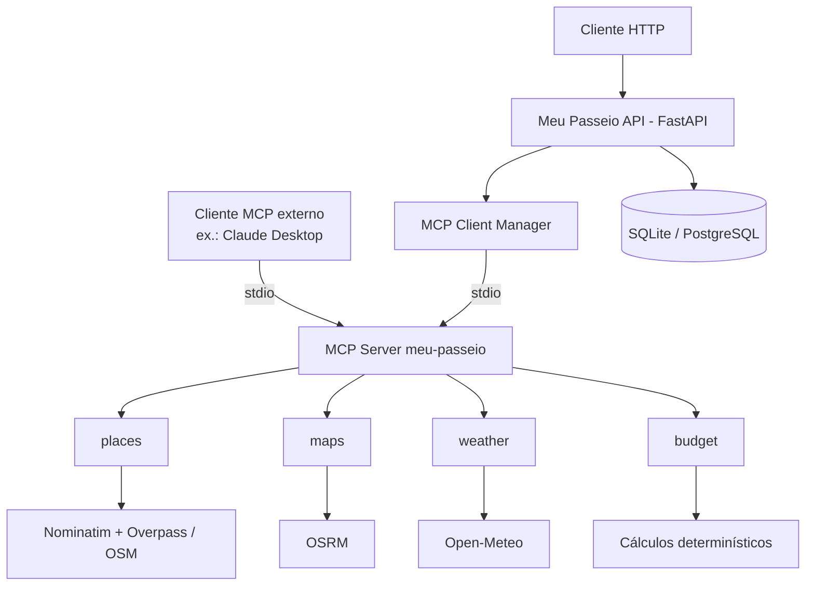

# Meu Passeio

**MCP Server (Model Context Protocol)** de planejamento de viagens: um único server com tools
de lugares, mapas, clima e orçamento, mais o prompt `planejar_viagem`. Acompanha uma API
**FastAPI** que se conecta a ele como MCP Client, expõe as tools via HTTP e persiste roteiros.

O projeto não tem orquestrador nem integração interna com IA: o server é usado por qualquer
cliente MCP (por exemplo, Claude Desktop ou Claude Code), que combina as tools para montar o
roteiro; a API serve para inspecionar, chamar as tools e guardar roteiros montados pelo cliente.

**Stack:** Python 3.11+ · FastAPI · MCP Python SDK 2.x · SQLAlchemy (SQLite/PostgreSQL) ·
Google Maps Platform (Places API (New) + Routes API) · Open-Meteo · OpenStreetMap/OSRM como
alternativa sem chave.

## Arquitetura



## Estrutura

```text
meu-passeio-mcp/
├── config/mcp_servers.yaml          # server MCP conectado pela API (transport, comando, timeout, allowlist)
├── src/meu_passeio/
│   ├── api/                          # app FastAPI (lifespan conecta o server MCP) e dependências
│   ├── core/                         # settings (.env) e logging estruturado
│   ├── db/                           # engine/sessões SQLAlchemy
│   ├── shared/schemas.py             # modelos de domínio (TripPlan, TripDay, TripActivity…)
│   ├── texts/                        # TODOS os textos: descrições de tools/params, notas, erros, API
│   ├── modules/
│   │   ├── mcp/                      # MCP Client Manager, Tool Catalog, config e rotas /mcp
│   │   └── trips/                    # modelos, repositório, serviço e rotas /trips (CRUD)
│   └── mcp_server/                   # MCP Server único (server.py) + tools por área
│       ├── common/                   # HTTP, erros seguros, geo
│       ├── places/                   # search_places, search_restaurants, get_place_details
│       ├── maps/                     # calculate_distance, get_route, get_travel_time, optimize_stops
│       ├── weather/                  # get_forecast, get_weather_by_date
│       ├── budget/                   # combustível (ANP), refeições, custos e orçamento
│       └── planning/                 # bate-volta e agenda do dia
├── tests/
├── Dockerfile · docker-compose.yml
└── pyproject.toml
```

## MCP Server

| Área | Tools | Provedor |
|---|---|---|
| **places** | `search_places`, `search_restaurants`, `get_place_details`, `check_opening_hours`, `find_nearby`, `search_along_route` | **Google Places API (New)**: nota, nº de avaliações, nível e faixa de preço, horários (com feriados nos próximos 7 dias), avaliações, comodidades. Alternativa: OpenStreetMap (Overpass + Nominatim) |
| **maps** | `calculate_distance`, `get_route`, `estimate_toll_costs`, `get_travel_time`, `optimize_stops` | **Google Routes API**: trânsito para o horário de saída, pedágios em R$, rotas alternativas, ordem otimizada de paradas. Alternativa: OSRM (sem trânsito e sem pedágio) |
| **weather** | `get_forecast`, `get_weather_by_date` | Open-Meteo — até 16 dias à frente; datas além disso são sinalizadas |
| **budget** | `get_fuel_price`, `calculate_fuel_cost`, `estimate_meal_cost`, `estimate_trip_cost`, `calculate_budget_breakdown` | **ANP** (preço de combustível por município, últimas 2 semanas, com média do estado quando a cidade não é pesquisada); **Google Maps** (custo de refeição pela faixa de preço dos restaurantes); consolidação com a fonte de cada valor (real × suposição) |
| **planning** | `suggest_day_trip_destinations`, `optimize_day_itinerary` | Bate-voltas até X horas de carro (atrações bem avaliadas agrupadas por município, tempo real com trânsito) e agenda do dia (ordem otimizada, horários de chegada/saída, conferência de funcionamento) |

Tudo roda num único processo (`python -m meu_passeio.mcp_server`) que fala MCP via stdio. As
instruções do server explicam como combinar as áreas para montar um roteiro, e o prompt
`planejar_viagem` (destino, dias, origem, pessoas, orçamento, preferências) entrega um pedido
pronto no cliente. Exemplo de configuração em um cliente MCP externo:

```json
{
  "mcpServers": {
    "meu-passeio": {
      "command": "C:/caminho/meu-passeio-mcp/.venv/Scripts/python.exe",
      "args": ["-m", "meu_passeio.mcp_server"]
    }
  }
}
```

Todos os textos (instruções do server, prompt, descrições de tools, parâmetros e campos, notas,
mensagens de erro e textos da API) ficam em `src/meu_passeio/texts/`, um arquivo por área —
para revisar ou traduzir, edite só esses arquivos.

Dados que o provedor não fornece (ex.: avaliações no OSM) voltam como `null` — nunca inventados.
Todo resultado carrega a origem (`source`) e erros de provedor viram mensagens seguras (`is_error`).

## Como rodar

```powershell
python -m venv .venv
.\.venv\Scripts\Activate.ps1
pip install -e ".[dev]"
copy .env.example .env   # coloque sua GOOGLE_MAPS_API_KEY
uvicorn meu_passeio.api.main:app --reload
```

### Google Maps

1. No [Google Cloud Console](https://console.cloud.google.com/), crie um projeto com faturamento.
2. Ative **Places API (New)** e **Routes API**.
3. Crie uma chave de API restrita a essas duas APIs.
4. Coloque-a em `GOOGLE_MAPS_API_KEY` no `.env` da raiz do projeto. O server lê esse arquivo
   pelo caminho absoluto, então funciona mesmo quando iniciado pelo Claude Desktop.

As chamadas pedem só os campos necessários (`X-Goog-FieldMask`), mas nota, preço e horários são
campos dos níveis mais caros da Places API: confira a cota gratuita e a tabela de preços no
console. Sem chave, ou se o Google falhar, as tools usam OpenStreetMap/OSRM e avisam em `notes`.
Dados do Google devem ser exibidos com atribuição ("Google Maps").

Abra `http://localhost:8000/docs`. O MCP Server é iniciado pela própria API no startup.

Com Docker (API + PostgreSQL):

```powershell
docker compose up --build
```

### Endpoints

| Método | Rota | Descrição |
|---|---|---|
| `GET` | `/health` | Status da API e do MCP Server |
| `GET` | `/mcp/servers` | Conexões MCP, status e tools descobertas |
| `GET` | `/mcp/tools` | Catálogo de tools (nome, server, schema) |
| `POST` | `/mcp/tools/{server}/{tool}` | Executa uma tool (desative em produção com `MEU_PASSEIO_ENABLE_TOOL_DEBUG_ENDPOINT=false`) |
| `POST` | `/mcp/servers/{server}/reconnect` | Reconecta um server |
| `POST` | `/trips` | Salva um roteiro (`TripPlan`) |
| `GET` | `/trips` · `/trips/{id}` | Lista / detalha roteiros |
| `PUT` | `/trips/{id}` | Substitui um roteiro |
| `DELETE` | `/trips/{id}` | Remove um roteiro |

Exemplo — chamar uma tool pela API:

```powershell
curl -X POST http://localhost:8000/mcp/tools/meu-passeio/search_places -H "content-type: application/json" `
  -d '{"location": "Curitiba, PR, Brasil", "categories": ["park", "museum"], "radius_km": 5, "limit": 5}'
```

## Segurança, limites e observabilidade

- **Allowlist de tools** por server (`allowed_tools` no YAML).
- **Validação** de argumentos com JSON Schema antes de chamar o server; roteiros validados com Pydantic.
- **Timeouts e retries** por server; reconexão automática; falha de um server não derruba a API.
- **Secrets** apenas em variáveis de ambiente; nunca no repositório ou nos logs.
- **Logs estruturados (JSON)** por tool call: `mcpServer`, `tool`, `durationMs`, `status`,
  `resultCount` — sem payloads ou dados pessoais.

## Testes

```powershell
pytest
```

Inclui testes unitários (budget e catálogo), integração real via stdio com o MCP Server e
testes ponta a ponta da API.

## Roadmap

- [ ] Frontend (React) com cards, mapa e roteiro por dia
- [ ] Transporte streamable HTTP para uso remoto
- [ ] Migrações com Alembic
- [x] Google Maps (lugares e rotas) — Fase 1
- [x] Custos reais (ANP, refeições) e planejamento de bate-volta/dia — Fase 2
- [ ] Clima histórico, nascer/pôr do sol, feriados, câmbio — Fase 3
- [ ] Tools de hospedagem e de transporte
