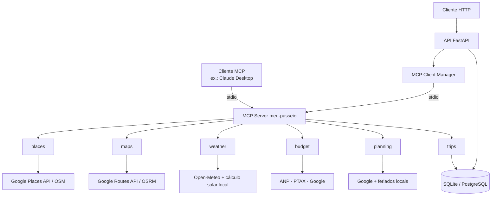

# Meu Passeio

**MCP Server (Model Context Protocol) de planejamento de viagens** — de um bate-volta a férias
com várias cidades. Um único server expõe **28 tools** de lugares, rotas, clima, custos,
planejamento e roteiros salvos, além do prompt `planejar_viagem`, para qualquer cliente MCP
(Claude Desktop, Claude Code etc.).

O projeto **não tem orquestrador nem IA interna**: quem planeja é o cliente MCP, combinando as
tools. O server entrega dados reais e verificáveis — lugares com nota e número de avaliações,
rotas com trânsito e pedágio, preço de combustível da ANP, câmbio do Banco Central — e marca o
que é estimativa. Uma API **FastAPI** acompanha o projeto para inspecionar e chamar as tools via
HTTP e guardar roteiros.

> "Quero um bate-volta saindo de Marília, até 2 horas de carro, com natureza e orçamento de R$ 400."

**Stack:** Python 3.11+ · MCP Python SDK 2.x · FastAPI · SQLAlchemy (SQLite/PostgreSQL) · httpx ·
Google Maps Platform (Places API (New) + Routes API) · Open-Meteo · ANP · Banco Central (PTAX) ·
OpenStreetMap/OSRM como alternativa sem chave.

## Sumário

- [Arquitetura](#arquitetura)
- [Tools](#tools)
- [Fontes de dados](#fontes-de-dados)
- [Instalação](#instalação)
- [Chave do Google Maps](#chave-do-google-maps)
- [Usar no Claude Desktop](#usar-no-claude-desktop)
- [API HTTP](#api-http)
- [Configuração](#configuração)
- [Estrutura do projeto](#estrutura-do-projeto)
- [Testes](#testes)
- [Segurança e limites](#segurança-e-limites)
- [Roadmap](#roadmap)

## Arquitetura



- **Um processo, seis áreas.** `python -m meu_passeio.mcp_server` sobe o server via stdio; cada
  área (`places`, `maps`, `weather`, `budget`, `planning`, `trips`) registra suas tools nele.
- **Google primeiro, alternativa gratuita depois.** Com `GOOGLE_MAPS_API_KEY`, lugares e rotas
  vêm do Google; sem a chave (ou se o Google falhar), as tools usam OpenStreetMap/OSRM e avisam
  em `notes`. Tools que só existem com o Google respondem com uma mensagem clara.
- **Dados com origem.** Todo resultado traz `source`; o que o provedor não fornece volta `null`,
  nunca inventado. Custos separam dado real de suposição.
- **Textos centralizados.** Instruções do server, descrições de tools e parâmetros, notas e
  mensagens de erro ficam em `src/meu_passeio/texts/`, um arquivo por área.

## Tools

### Lugares — `places`

| Tool | O que faz |
|---|---|
| `search_places` | Atrações, natureza, cultura, compras e alimentação perto de uma cidade ou coordenada. Com Google: nota, nº de avaliações, nível e faixa de preço, aberto agora, link do Maps. Filtros `min_rating`, `min_reviews`, `open_now`, `price_levels`; ordena por qualidade (nota ponderada pelo nº de avaliações), distância ou popularidade. |
| `search_restaurants` | Restaurantes, cafés, bares, padarias e sorveterias, com filtro de culinária e faixa de preço por pessoa. |
| `get_place_details` | Horários de cada dia, resumo, telefone, site, até 5 avaliações, acessibilidade, estacionamento, pagamento e comodidades. |
| `check_opening_hours` | Diz se o lugar estará aberto numa data e hora; nos próximos 7 dias considera feriados e horários especiais. |
| `find_nearby` | O que há perto de um lugar escolhido (ex.: restaurante bem avaliado a 500 m do museu). |
| `search_along_route` | Paradas ao longo do trajeto (postos, restaurantes, mirantes). *Requer Google.* |

### Rotas — `maps`

| Tool | O que faz |
|---|---|
| `calculate_distance` | Distância em linha reta entre dois pontos (local, sem API). |
| `get_route` | Rota por coordenadas, endereço ou `place_id`: duração com e sem trânsito, rodovias, avisos, pedágios em R$, alternativas, evitar pedágios/rodovias; modos carro, a pé, bicicleta e transporte público (este só com Google). |
| `estimate_toll_costs` | Pedágios de ida, ou ida e volta, com as tarifas conhecidas pelo Google. *Requer Google.* |
| `get_travel_time` | Matriz de tempos e distâncias entre várias origens e destinos, com trânsito. |
| `optimize_stops` | Melhor ordem para várias paradas, com a duração de cada trecho. |

### Clima — `weather`

| Tool | O que faz |
|---|---|
| `get_forecast` | Previsão diária (condição, temperaturas, chuva, vento, UV) até 16 dias. |
| `get_weather_by_date` | Previsão para uma data específica. |
| `get_climate_normals` | Como o tempo costuma ser num período do ano: médias das mesmas datas nos últimos 10 anos (3 a 30), com chance de dia chuvoso, extremos e horas de sol. Para viagens além da previsão. |
| `get_sun_times` | Nascer e pôr do sol, crepúsculo, hora dourada e duração do dia para qualquer data, no fuso do lugar. |

### Custos — `budget`

| Tool | O que faz |
|---|---|
| `get_fuel_price` | Preço de gasolina, aditivada, etanol, diesel, diesel S10 ou GNV na cidade, pela pesquisa da ANP (média, mediana, mínimo e máximo das últimas 2 semanas). Cidade fora da pesquisa usa a média do estado. |
| `calculate_fuel_cost` | Custo de combustível de um trajeto; sem preço informado, usa o da ANP na cidade de abastecimento. |
| `estimate_meal_cost` | Custo por pessoa de café da manhã, almoço, jantar, lanche ou refeição rápida, pela faixa de preço real dos estabelecimentos bem avaliados. *Requer Google.* |
| `convert_currency` | Câmbio oficial pela PTAX do Banco Central (USD, EUR, GBP, JPY, CHF, CAD, AUD, DKK, NOK, SEK), com taxa cruzada via real. |
| `estimate_trip_cost` | Consolida custos informando a fonte de cada item (`google_maps`, `anp`, `google_routes_tolls`, `user`, `assumption`) e mostra quanto do total é suposição. |
| `calculate_budget_breakdown` | Sugere a divisão de um orçamento por categoria e por dia. |

### Planejamento — `planning`

| Tool | O que faz |
|---|---|
| `suggest_day_trip_destinations` | Destinos de bate-volta até X horas de carro: atrações bem avaliadas agrupadas por município, com o tempo real de viagem (com trânsito). *Requer Google.* |
| `optimize_day_itinerary` | Agenda do dia: ordena as paradas, calcula chegada e saída de cada uma e confere o horário de funcionamento (espera abrir, fechado, fecha antes do fim da visita). |
| `get_holidays` | Feriados nacionais e pontos facultativos num período, com fins de semana prolongados e emendas. |

### Roteiros — `trips`

| Tool | O que faz |
|---|---|
| `save_trip` | Salva um roteiro (`TripPlan`) e devolve o ID. |
| `list_trips` | Lista os roteiros salvos. |
| `get_trip` | Abre um roteiro pelo ID. |
| `update_trip` | Substitui o plano de um roteiro salvo. |

Os roteiros ficam no mesmo banco da API: um roteiro salvo pelo Claude aparece em `GET /trips`.

### Prompt `planejar_viagem`

Modelo de pedido que aparece no cliente MCP, com os argumentos destino, dias, origem, pessoas,
orçamento e preferências. É só um texto pronto que orienta o fluxo de uso das tools.

## Fontes de dados

| Fonte | Usada para | Chave |
|---|---|---|
| [Google Places API (New)](https://developers.google.com/maps/documentation/places/web-service/op-overview) | Lugares, notas, preços, horários, avaliações | Sim |
| [Google Routes API](https://developers.google.com/maps/documentation/routes) | Rotas com trânsito, pedágios, matriz de tempos, ordem de paradas | Sim |
| [Open-Meteo](https://open-meteo.com/) | Previsão, histórico (ERA5) e fuso horário do local | Não |
| [ANP — dados abertos](https://www.gov.br/anp/pt-br/centrais-de-conteudo/dados-abertos/serie-historica-de-precos-de-combustiveis) | Preço de combustível por município (arquivo das últimas 4 semanas, em cache por 12 h) | Não |
| [Banco Central — PTAX](https://dadosabertos.bcb.gov.br/) | Câmbio oficial de fechamento | Não |
| [OpenStreetMap](https://www.openstreetmap.org/) (Nominatim + Overpass) e [OSRM](https://routing.openstreetmap.de/) | Geocodificação e alternativa sem chave para lugares e rotas | Não |
| Cálculo local | Nascer/pôr do sol (algoritmo da NOAA) e feriados nacionais (leis federais + Páscoa) | — |

Ao exibir dados do Google, cite "Google Maps" como fonte (as tools devolvem `attribution`).

## Instalação

Requer Python 3.11+.

```powershell
git clone https://github.com/otaviosbms/meu-passeio-mcp.git
cd meu-passeio-mcp
python -m venv .venv
.\.venv\Scripts\Activate.ps1
pip install -e ".[dev]"
Copy-Item .env.example .env
```

Sem a chave do Google, o server já funciona com as alternativas gratuitas; com ela, lugares e
rotas ficam muito mais precisos.

## Chave do Google Maps

1. Acesse o [Google Cloud Console](https://console.cloud.google.com/) e crie um projeto.
2. Em **Faturamento**, vincule uma conta de faturamento (o Google exige cartão, mesmo dentro da
   cota gratuita).
3. Em **APIs e serviços → Biblioteca**, ative **Places API (New)** (não a "Places API" antiga) e
   **Routes API**.
4. Em **APIs e serviços → Credenciais**, crie uma **Chave de API**.
5. Restrinja a chave: em **Restrições de API**, permita só **Places API (New)** e **Routes API**.
6. No `.env` da raiz do projeto, preencha `GOOGLE_MAPS_API_KEY=sua-chave`.

O `.env` está no `.gitignore` e é lido pelo caminho absoluto do projeto, então funciona mesmo
quando o server é iniciado pelo Claude Desktop.

**Custos:** o Google Maps Platform cobra por chamada, com uma cota gratuita mensal por tipo de
chamada. As tools pedem só os campos necessários (`X-Goog-FieldMask`), mas nota, preço e
horários estão nos níveis mais caros da Places API. Confira a
[tabela de preços](https://mapsplatform.google.com/pricing/) e, no console, crie um alerta de
orçamento (**Faturamento → Orçamentos e alertas**) e limites diários (**Cotas** de cada API).

## Usar no Claude Desktop

Adicione o server à configuração de MCP do Claude Desktop (`claude_desktop_config.json`,
acessível em **Configurações → Desenvolvedor → Editar configuração**):

```json
{
  "mcpServers": {
    "meu-passeio": {
      "command": "C:\\caminho\\meu-passeio-mcp\\.venv\\Scripts\\python.exe",
      "args": ["-m", "meu_passeio.mcp_server"],
      "env": { "PYTHONIOENCODING": "utf-8" }
    }
  }
}
```

Reinicie o Claude Desktop (inclusive pela bandeja do Windows). O conector **Meu Passeio** aparece
com as 28 tools e o prompt **Planejar viagem**. Não é preciso deixar nada rodando: o Claude
inicia o server quando precisa.

Para testar o server isolado:

```powershell
python -m meu_passeio.mcp_server
```

## API HTTP

```powershell
uvicorn meu_passeio.api.main:app --reload
```

Abra `http://localhost:8000/docs`. A API inicia o MCP Server como processo filho e se conecta a
ele (config em `config/mcp_servers.yaml`).

| Método | Rota | Descrição |
|---|---|---|
| `GET` | `/health` | Status da API e do MCP Server |
| `GET` | `/mcp/servers` | Conexões MCP, status e tools descobertas |
| `GET` | `/mcp/tools` | Catálogo de tools (nome, server, schema) |
| `POST` | `/mcp/tools/{server}/{tool}` | Executa uma tool (desative em produção) |
| `POST` | `/mcp/servers/{server}/reconnect` | Reconecta um server |
| `POST` | `/trips` | Salva um roteiro (`TripPlan`) |
| `GET` | `/trips` · `/trips/{id}` | Lista / detalha roteiros |
| `PUT` | `/trips/{id}` | Substitui um roteiro |
| `DELETE` | `/trips/{id}` | Remove um roteiro |

Exemplo — chamar uma tool pela API:

```powershell
curl -X POST http://localhost:8000/mcp/tools/meu-passeio/get_fuel_price `
  -H "content-type: application/json" `
  -d '{"state": "SP", "city": "Marília", "fuel": "gasolina"}'
```

Com Docker (API + PostgreSQL):

```powershell
docker compose up --build
```

## Configuração

Variáveis lidas do `.env` (veja `.env.example`):

| Variável | Padrão | Descrição |
|---|---|---|
| `GOOGLE_MAPS_API_KEY` | — | Chave do Google Maps Platform (opcional, recomendada) |
| `MEU_PASSEIO_GOOGLE_LANGUAGE` / `MEU_PASSEIO_GOOGLE_REGION` | `pt-BR` / `BR` | Idioma e região das respostas do Google |
| `MEU_PASSEIO_DATABASE_URL` | SQLite em `meu_passeio.db` | Banco dos roteiros (`postgresql+asyncpg://…` para PostgreSQL) |
| `MEU_PASSEIO_LOG_LEVEL` | `INFO` | Nível de log (JSON no stderr) |
| `MEU_PASSEIO_ENABLE_TOOL_DEBUG_ENDPOINT` | `true` | Habilita `POST /mcp/tools/{server}/{tool}` |
| `MEU_PASSEIO_HTTP_USER_AGENT` | genérico | User-Agent para OSM/Nominatim (recomenda-se um contato próprio) |
| `NOMINATIM_URL`, `OVERPASS_URLS`, `OSRM_BASE_URL` | instâncias públicas | Alternativas sem chave |
| `OVERPASS_TIMEOUT_SECONDS`, `OVERPASS_COOLDOWN_SECONDS` | `20`, `120` | Timeout por instância e pausa após falhas (circuit breaker) |
| `ANP_FUEL_BASE_URL`, `ANP_CACHE_TTL_SECONDS` | gov.br, `43200` | Origem e cache dos preços da ANP |
| `BCB_PTAX_URL` | API Olinda do BC | Endpoint da PTAX |
| `OPEN_METEO_FORECAST_URL`, `OPEN_METEO_ARCHIVE_URL`, `OPEN_METEO_GEOCODING_URL` | Open-Meteo | Endpoints de clima |

## Estrutura do projeto

```text
meu-passeio-mcp/
├── config/mcp_servers.yaml           # server MCP conectado pela API
├── src/meu_passeio/
│   ├── mcp_server/                   # MCP Server único
│   │   ├── server.py                 # cria o MCPServer, registra as áreas e o prompt
│   │   ├── common/                   # cliente Google, HTTP, erros seguros, geo
│   │   ├── places/                   # Google Places + OSM, horários de funcionamento
│   │   ├── maps/                     # Google Routes + OSRM
│   │   ├── weather/                  # previsão, médias climáticas, cálculo solar
│   │   ├── budget/                   # ANP, refeições, câmbio (PTAX), custos
│   │   ├── planning/                 # bate-volta, agenda do dia, feriados
│   │   └── trips/                    # roteiros salvos
│   ├── texts/                        # todos os textos (um arquivo por área)
│   ├── api/                          # app FastAPI
│   ├── modules/
│   │   ├── mcp/                      # MCP Client Manager, catálogo de tools, rotas /mcp
│   │   └── trips/                    # modelos, repositório, serviço e rotas /trips
│   ├── core/                         # configuração (.env) e logging
│   ├── db/                           # SQLAlchemy
│   └── shared/schemas.py             # TripPlan, Waypoint, Coordinates…
├── tests/
├── Dockerfile · docker-compose.yml
└── pyproject.toml
```

Cada área segue o mesmo padrão: `tools.py` (definição das tools e `register(mcp)`),
`service.py` (escolha do provider e fallback) e um módulo por provider.

## Testes

```powershell
pytest
```

46 testes, sem chamadas de rede (exceto o MCP Server real via stdio):

- unitários: cálculos de orçamento, catálogo de tools, horários de funcionamento, cálculo solar,
  médias climáticas, feriados e Páscoa;
- Google Places e Routes com respostas simuladas (`tests/google_fakes.py`), incluindo fallback e
  garantia de que a chave não vaza em mensagens;
- ANP e PTAX com dados simulados;
- integração real via stdio entre o MCP Client Manager e o server;
- ponta a ponta da API (`/health`, `/mcp/*`, `/trips`).

Lint: `ruff check src tests`.

## Segurança e limites

- **Chaves** só em variáveis de ambiente; a do Google vai no header `X-Goog-Api-Key`, nunca em
  URLs, logs ou respostas.
- **Validação** dos argumentos de cada tool (Pydantic no server, JSON Schema no client).
- **Erros seguros**: falhas de provedor viram mensagens claras (`is_error`), sem detalhes internos.
- **Resiliência**: timeouts, retries e reconexão no client; failover entre instâncias do Overpass
  com circuit breaker; alternativas OSM/OSRM quando o Google falha.
- **Allowlist** de tools por server (`allowed_tools` no YAML da API).
- **Logs estruturados** (JSON) por chamada de tool: server, tool, duração, status e nº de
  resultados — sem payloads ou dados pessoais.

## Roadmap

- [x] Server MCP único com lugares, rotas, clima e orçamento
- [x] Google Maps (lugares e rotas) com alternativa OSM/OSRM — Fase 1
- [x] Custos reais (ANP, refeições) e planejamento de bate-volta e do dia — Fase 2
- [x] Clima histórico, horários do sol, feriados, câmbio e roteiros salvos — Fase 3
- [ ] Hospedagem com preço de diária (APIs de hotelaria)
- [ ] Transporte intermunicipal (ônibus, voos)
- [ ] Feriados estaduais e municipais
- [ ] Transporte streamable HTTP para uso remoto
- [ ] Frontend com mapa e roteiro por dia
- [ ] Migrações com Alembic
