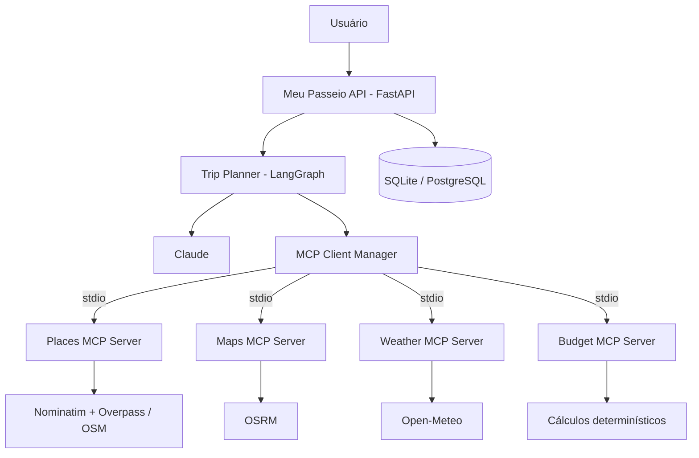
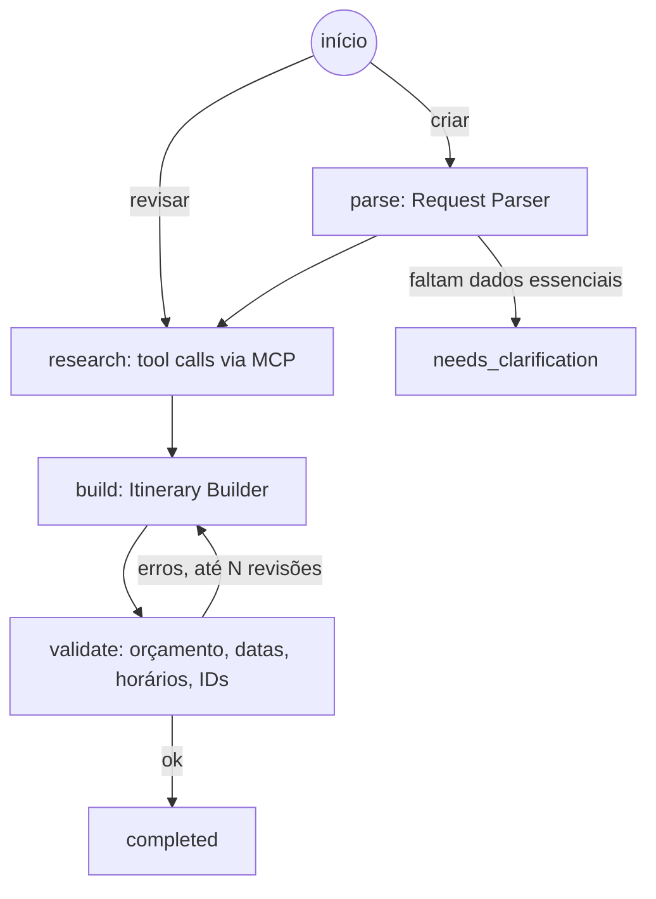

# Meu Passeio

Planejador de viagens com IA que usa **MCP (Model Context Protocol)** como camada padronizada de
integração com ferramentas especializadas. O usuário descreve a viagem em linguagem natural — de
um bate-volta a férias com várias cidades — e o Meu Passeio devolve um roteiro estruturado, com
lugares reais, deslocamentos, clima e estimativas de custo.

> "Quero um bate-volta saindo de Marília, até duas horas de carro, com natureza e orçamento de R$ 400."

**Stack:** Python 3.11+ · FastAPI · MCP Python SDK 2.x · LangGraph · Claude (Anthropic SDK) ·
SQLAlchemy (SQLite/PostgreSQL) · OpenStreetMap / OSRM / Open-Meteo (sem API keys).

## Arquitetura



**Princípio central:** o agente decide *quais capacidades usar e como combinar os resultados*;
o MCP padroniza *como essas capacidades são disponibilizadas e chamadas*; e o backend mantém
*regras, validação, estado, segurança e persistência*.

### Workflow do planner (LangGraph)



- **parse** — extrai destino, datas, viajantes, orçamento e preferências (structured output).
- **research** — loop de tool use com allowlist, limites de iterações/chamadas e chamadas paralelas.
- **build** — monta o `TripPlan` só com dados das ferramentas (sem inventar lugares/horários).
- **validate** — checagens determinísticas; erros voltam ao builder como feedback.
- **revise** — edição conversacional: altera o mínimo e preserva o restante do roteiro.

## Estrutura

```text
meu-passeio-mcp/
├── config/mcp_servers.yaml          # servers MCP conectados (transport, comando, timeout, allowlist)
├── src/meu_passeio/
│   ├── api/                          # app FastAPI (lifespan = host MCP) e dependências
│   ├── core/                         # settings (.env) e logging estruturado
│   ├── db/                           # engine/sessões SQLAlchemy
│   ├── shared/schemas.py             # modelos de domínio (TripPlan, TripDay, TripActivity…)
│   ├── modules/
│   │   ├── mcp/                      # MCP Client Manager, Tool Catalog, config e rotas /mcp
│   │   ├── planner/                  # grafo LangGraph, prompts, LLM, validator, schemas
│   │   └── trips/                    # modelos, repositório, serviço e rotas /trips
│   └── mcp_servers/                  # MCP Servers independentes (reutilizáveis por outros clients)
│       ├── common/                   # HTTP, erros seguros, geo
│       ├── places/                   # search_places, search_restaurants, get_place_details
│       ├── maps/                     # calculate_distance, get_route, get_travel_time, optimize_stops
│       ├── weather/                  # get_forecast, get_weather_by_date
│       └── budget/                   # calculate_fuel_cost, estimate_trip_cost, calculate_budget_breakdown
├── tests/
├── Dockerfile · docker-compose.yml
└── pyproject.toml
```

## MCP Servers

| Server | Tools | Provedor |
|---|---|---|
| **places** | `search_places`, `search_restaurants`, `get_place_details` | OpenStreetMap (Overpass com failover entre instâncias + circuit breaker; fallback no Nominatim) |
| **maps** | `calculate_distance`, `get_route`, `get_travel_time`, `optimize_stops` | OSRM (`routing.openstreetmap.de`) — sem trânsito em tempo real |
| **weather** | `get_forecast`, `get_weather_by_date` | Open-Meteo — até 16 dias à frente; datas além disso são sinalizadas |
| **budget** | `calculate_fuel_cost`, `estimate_trip_cost`, `calculate_budget_breakdown` | Cálculos próprios, determinísticos |

Cada server é um processo independente (`python -m meu_passeio.mcp_servers.<nome>`) que fala MCP
via stdio e pode ser usado por qualquer MCP Client — inclusive o Claude Desktop/Claude Code:

```json
{
  "mcpServers": {
    "meu-passeio-places": {
      "command": "C:/caminho/meu-passeio-mcp/.venv/Scripts/python.exe",
      "args": ["-m", "meu_passeio.mcp_servers.places"]
    }
  }
}
```

Dados que o provedor não fornece (ex.: avaliações no OSM) voltam como `null` — nunca inventados.
Todo resultado carrega a origem (`source`) e erros de provedor viram mensagens seguras (`is_error`).

## Como rodar

```powershell
python -m venv .venv
.\.venv\Scripts\Activate.ps1
pip install -e ".[dev]"
copy .env.example .env   # preencha ANTHROPIC_API_KEY
uvicorn meu_passeio.api.main:app --reload
```

Abra `http://localhost:8000/docs`. Os MCP Servers são iniciados pela própria API no startup.

Com Docker (API + PostgreSQL):

```powershell
docker compose up --build
```

### Endpoints

| Método | Rota | Descrição |
|---|---|---|
| `GET` | `/health` | Status da API e de cada MCP Server |
| `GET` | `/mcp/servers` | Conexões MCP, status e tools descobertas |
| `GET` | `/mcp/tools` | Catálogo de tools (nome, server, schema) |
| `POST` | `/mcp/tools/{server}/{tool}` | Executa uma tool diretamente (debug; desative em produção) |
| `POST` | `/mcp/servers/{server}/reconnect` | Reconecta um server |
| `POST` | `/trips` | Planeja uma viagem a partir de texto livre |
| `GET` | `/trips` · `/trips/{id}` | Lista / detalha viagens |
| `POST` | `/trips/{id}/clarify` | Responde às perguntas do planner |
| `POST` | `/trips/{id}/revise` | Edição conversacional do roteiro |
| `DELETE` | `/trips/{id}` | Remove a viagem |

Exemplo:

```powershell
curl -X POST http://localhost:8000/trips -H "content-type: application/json" `
  -d '{"request": "Planeje 4 dias em Campos do Jordão em julho, para 2 pessoas, de carro. Natureza e restaurantes; orçamento de R$ 1.800 sem hospedagem."}'
```

## Segurança, limites e observabilidade

- **Allowlist de tools** por server (`allowed_tools` no YAML) e por etapa do workflow.
- **Validação** de argumentos com JSON Schema antes de chamar o server; saídas validadas com Pydantic.
- **Timeouts e retries** por server; reconexão automática; falha de um server não derruba a API.
- **Prompt injection:** resultados de tools são tratados como dados, nunca como instruções.
- **Controle de custo:** limites de iterações, de chamadas de tools e de revisões (`.env`).
- **Secrets** apenas em variáveis de ambiente; nunca no repositório, nos logs ou no prompt.
- **Logs estruturados (JSON)** por tool call: `tripId`, `workflowRunId`, `mcpServer`, `tool`,
  `durationMs`, `status`, `resultCount` — sem payloads ou dados pessoais.
- **LLM:** Claude (`claude-opus-5-5`, effort configurável) com fallback server-side em caso de
  recusa (`MEU_PASSEIO_LLM_ENABLE_FALLBACKS`).

## Testes

```powershell
pytest
```

Inclui testes unitários (budget, catálogo, validator), integração real via stdio com o Budget
MCP Server e testes ponta a ponta da API com um LLM simulado (sem custo de API).

## Roadmap

- [x] Fase 1 — MCP Client + Places/Weather + agente + schema validado + API
- [x] Fase 2 — Maps, agrupamento por região, Budget, persistência
- [x] Fase 3 — edição conversacional (revise) preservando o restante do roteiro
- [ ] Frontend (React) com cards, mapa e roteiro por dia
- [ ] Transporte streamable HTTP para servers remotos
- [ ] Execução assíncrona do planejamento (fila + polling/SSE)
- [ ] Migrações com Alembic
- [ ] Accommodation e Transport MCP Servers
