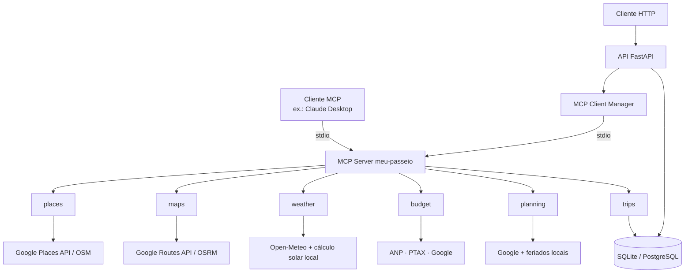

# Arquitetura

[← Voltar ao README](../README.md)



## Princípios

- **Sem IA interna.** O projeto não tem orquestrador: quem planeja é o cliente MCP, combinando as
  tools. O server entrega dados e cálculos; as instruções do server sugerem o fluxo de uso.
- **Um processo, seis áreas.** `python -m meu_passeio.mcp_server` sobe o server via stdio; cada
  área (`places`, `maps`, `weather`, `budget`, `planning`, `trips`) registra suas tools nele.
- **Google primeiro, alternativa gratuita depois.** Com `GOOGLE_MAPS_API_KEY`, lugares e rotas
  vêm do Google; sem a chave (ou se o Google falhar), as tools usam OpenStreetMap/OSRM e avisam
  em `notes`. Tools que só existem com o Google respondem com uma mensagem clara.
- **Dados com origem.** Todo resultado traz `source`; o que o provedor não fornece volta `null`,
  nunca inventado. Custos separam dado real de suposição.
- **Textos centralizados.** Instruções do server, descrições de tools e parâmetros, notas e
  mensagens de erro ficam em `src/meu_passeio/texts/`, um arquivo por área.

## Estrutura do projeto

```text
meu-passeio-mcp/
├── config/mcp_servers.yaml           # server MCP conectado pela API
├── docs/                             # documentação
├── src/meu_passeio/
│   ├── mcp_server/                   # MCP Server único
│   │   ├── server.py                 # cria o MCPServer, registra as áreas e o prompt
│   │   ├── common/                   # cliente Google, HTTP, erros seguros, geo
│   │   ├── places/                   # Google Places + OSM, horários de funcionamento
│   │   ├── maps/                     # Google Routes + OSRM
│   │   ├── weather/                  # previsão, médias climáticas, cálculo solar
│   │   ├── budget/                   # ANP, refeições, câmbio (PTAX), custos
│   │   ├── planning/                 # bate-volta, agenda do dia, feriados
│   │   └── trips/                    # roteiros salvos
│   ├── texts/                        # todos os textos (um arquivo por área)
│   ├── api/                          # app FastAPI
│   ├── modules/
│   │   ├── mcp/                      # MCP Client Manager, catálogo de tools, rotas /mcp
│   │   └── trips/                    # modelos, repositório, serviço e rotas /trips
│   ├── core/                         # configuração (.env) e logging
│   ├── db/                           # SQLAlchemy
│   └── shared/schemas.py             # TripPlan, Waypoint, Coordinates…
├── tests/
├── Dockerfile · docker-compose.yml
└── pyproject.toml
```

## Padrão de cada área

| Arquivo | Papel |
|---|---|
| `tools.py` | Define as tools (parâmetros, validação) e `register(mcp)`, que as registra no server |
| `service.py` | Escolhe o provider (Google ou alternativa), faz o fallback e monta o resultado |
| `google.py`, `osm.py`, `osrm.py`, `fuel.py`… | Um módulo por provider: chamadas HTTP e conversão das respostas |
| `schemas.py` | Modelos Pydantic de entrada e saída |

O texto exibido ao cliente (descrições, notas, erros) vem sempre de `texts/<área>.py`.
